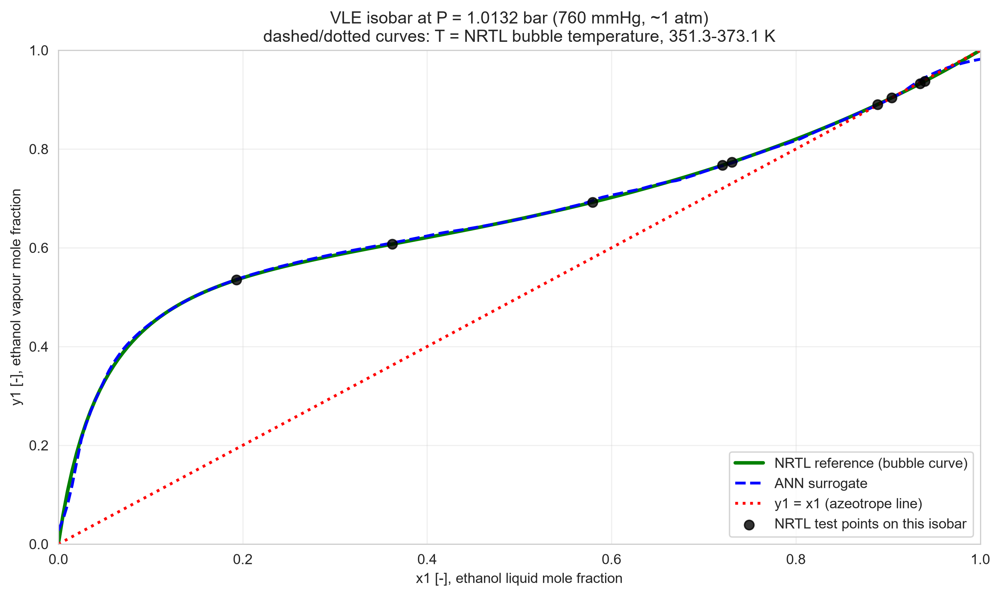
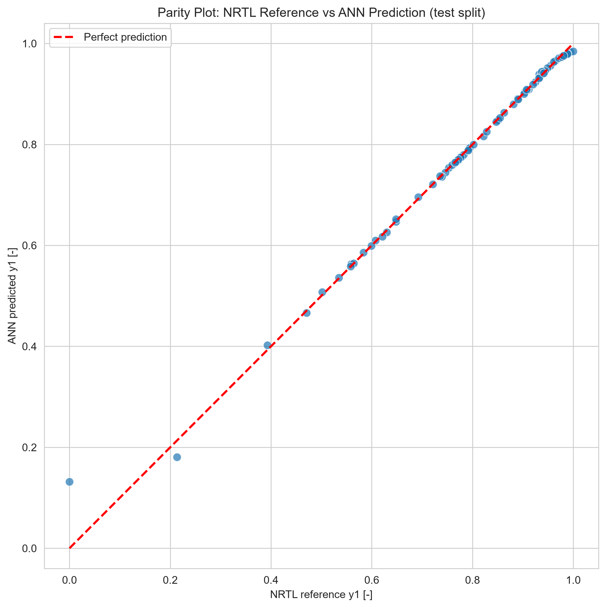
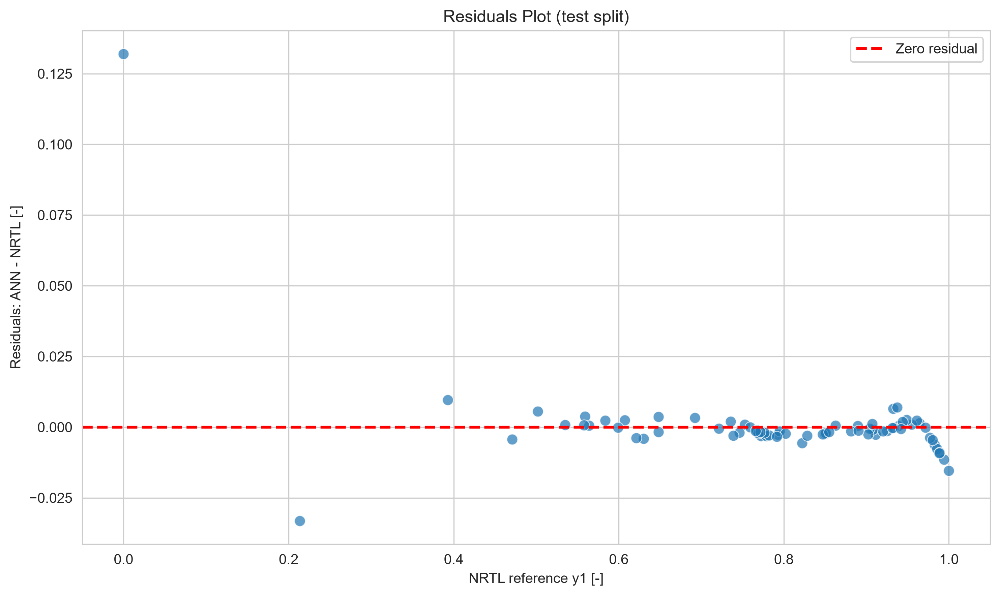
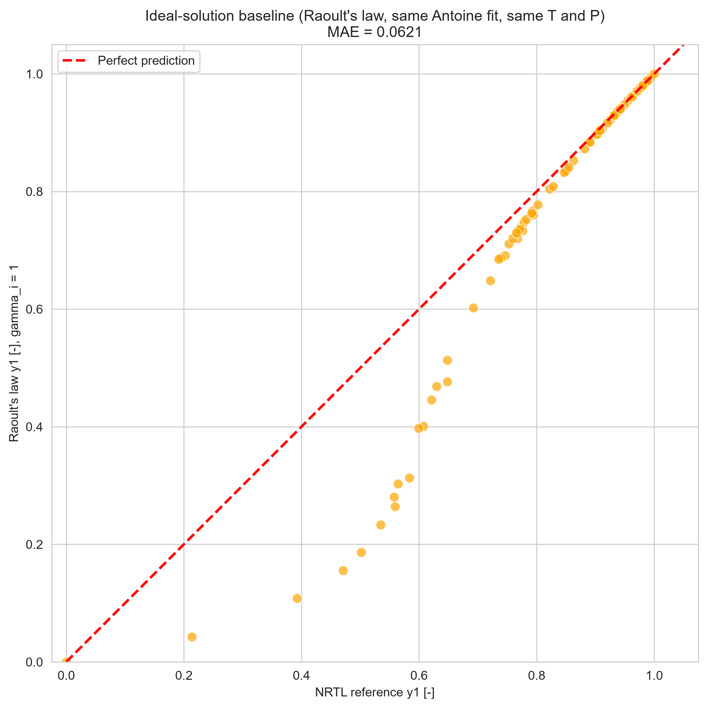

# Binary VLE ANN Surrogate Model (ethanol–water)

An **Artificial Neural Network surrogate** for the vapour–liquid equilibrium (VLE)
of ethanol(1)–water(2). Given liquid composition, temperature and pressure it
returns the ethanol vapour mole fraction `y1` in one forward pass, replacing the
iterative bubble-point calculation.

## Conventions and units

| Variable | Meaning | Unit |
| --- | --- | --- |
| `x1` | ethanol mole fraction, liquid | – (0–1) |
| `y1` | ethanol mole fraction, vapour | – (0–1) |
| `T` | temperature | **K** |
| `P` | pressure | **bar** |

`P` is stored and reported in **bar** (1 atm = 1.01325 bar). The original
isobars were specified as 200, 400, 760, 1000 and 1500 mmHg, which correspond to
0.26664, 0.53328, 1.01325, 1.33322 and 1.99984 bar.

## About the data: a thermodynamic reference set, not measurements

`Data/vle_data.csv` is **generated**, not measured. Every row is a bubble point of
the NRTL activity-coefficient model (α = 0.3) with Antoine vapour pressures, solved
in `data.py`:

```
x1·γ1(x1,T)·P1sat(T) + x2·γ2(x1,T)·P2sat(T) = P
y1 = x1·γ1(x1,T)·P1sat(T) / P
```

Consequences that matter when reading the results:

- The ANN is a **surrogate for this NRTL model**, not for laboratory data. All
  errors below are measured against the NRTL reference, so they quantify how well
  the network reproduces the thermodynamic model inside its training domain.
  They say nothing about the accuracy of NRTL itself against experiment.
- The NRTL parameters (`a12 = -0.81`, `b12 = 246`, `a21 = 3.46`, `b21 = -586`) are
  a literature fit for ethanol–water near atmospheric pressure. The model
  reproduces the azeotrope at x1 ≈ 0.903 / 78.2 °C (experimental: x1 ≈ 0.894 /
  78.2 °C); away from 1 atm it is a smooth extrapolation of that fit.
- Pure-component rows (`x1 = 0`, `x1 = 1`) are solved from the pure saturation
  condition `Pisat(T) = P` directly — no activity coefficients, and no literature
  boiling point pinned to the wrong pressure.
- The generator is **validated**, never clipped (see below): `validate_dataset()`
  re-solves every row and rejects the dataset if a row fails.

### Dataset

| | |
| --- | --- |
| Rows | 490 (5 isobars × 98 compositions) |
| `x1` range | 0.000 – 1.000, denser near the azeotrope and near pure ethanol |
| `T` range | 321.10 – 393.26 K (48.0 – 120.1 °C) |
| `P` range | 0.26664 – 1.99984 bar |
| Split | 342 train / 74 validation / 74 test (rows) |

The scaler is fitted on the **training split only** and then applied to
validation/test, so no test statistics leak into training.

## Model performance

Measured on the held-out test split, versus the NRTL reference
(`ANN_BinaryVLE/metrics.json`):

| Metric | Value |
| --- | --- |
| Test MAE | **0.005062** mole fraction |
| Test RMSE | **0.016316** mole fraction |
| Ideal-solution baseline MAE | 0.062112 |
| Improvement over baseline | **12.3×** |

### Why the baseline is what it is

The baseline is **Raoult's law** (`γi = 1`) evaluated with the *same* Antoine
correlations, at the *same* `(x1, T, P)` as each test point. It is not a fitted or
approximate stand-in: the only thing it drops relative to the reference is the
activity coefficient, i.e. exactly the non-ideality the surrogate has to learn, so
the MAE gap measures how much non-ideal behaviour the network captured. Reference
and baseline are computed with the same vapour-pressure correlation, which makes
the comparison apples-to-apples. (The previous README quoted ~0.093 for an
*invented* saturation-pressure correlation; that number was not comparable to
anything and has been replaced.)

## Model architecture

```
Input Layer:     3 neurons (x1, T, P)
Hidden Layer 1:  64 neurons (ReLU)
Hidden Layer 2: 128 neurons (ReLU)
Hidden Layer 3:  64 neurons (ReLU)
Output Layer:    1 neuron (sigmoid -> y1 in [0,1])
```

Training: Adam (lr = 0.001), MSE loss, batch size 32, up to 200 epochs, early
stopping on validation loss (patience 20), `ModelCheckpoint` on validation loss.

## Visualizations

### VLE isobar at an explicit T and P


Same y–x diagram, but with both coordinates fully specified: `P = 1.01325 bar`
(760 mmHg) exactly, and for every `x1` the temperature is the NRTL bubble
temperature at that pressure (351.3 – 373.1 K on this isobar). Green = NRTL
reference, blue = ANN surrogate, black dots = NRTL test points lying on this
isobar, red dotted = `y1 = x1`. The intersection with `y1 = x1` is the azeotrope
at x1 ≈ 0.903, T ≈ 351.3 K.

### Parity, residuals and baseline




## Setup

### pip
```bash
git clone <repository-url>
cd VLE-Azeotropic-Prediction
python -m venv venv
source venv/bin/activate        # Windows: venv\Scripts\activate
pip install -r requirements.txt
```

### uv (recommended)
```bash
uv venv .venv
source .venv/bin/activate       # Windows: .venv\Scripts\activate
uv sync --frozen
```

## Usage

```bash
python data.py                            # (optional) regenerate + validate Data/vle_data.csv
python preprocessing_training_saving.py   # train, evaluate, write ANN_BinaryVLE/ and the zip
python predict_from_saved_model.py        # reload artifacts, recreate plots
jupyter notebook test.ipynb               # the notebook only calls the modules above
```

`predict_from_saved()` warns when an input lies outside the training domain and
raises on `x1` outside [0, 1]:

```python
import numpy as np
from predict_from_saved_model import predict_from_saved

X_new = np.array([[0.5, 350.0, 1.01325]])   # x1, T [K], P [bar]
print(predict_from_saved(X_new)[0])         # -> vapour y1
```

## Data validation (instead of clipping)

`data.py` raises instead of returning a plausible-looking wrong number, and
`validate_dataset()` enforces, over the whole dataset:

- all values finite, `0 ≤ x1 ≤ 1`, `0 ≤ y1 ≤ 1`, `T > 0`, `P > 0`;
- each isobar has **at most one** composition sign change in `y1 - x1`
  (ethanol–water admits exactly one azeotrope);
- pure-component rows match the pure saturation temperature at their pressure
  (within 0.05 K) and have `y1 = x1` exactly;
- every row reproduces its own pressure from the bubble-point equation
  (within 1e-4 bar) and its own `y1` (within 2e-4).

Training runs the same validation on the loaded CSV, so an unphysical dataset
cannot be trained on silently.

## Project structure

```
VLE-Azeotropic-Prediction/
├── ANN.py                            # model definition + training loop
├── data.py                           # NRTL generator, bubble point, validation
├── preprocessing_training_saving.py  # split -> fit scaler (train only) -> train -> evaluate
├── predict_from_saved_model.py       # inference + plot recreation
├── test.ipynb                        # thin notebook wrapper around the modules
├── Data/vle_data.csv                 # NRTL reference dataset (490 rows)
├── requirements.txt
├── pyproject.toml
└── ANN_BinaryVLE/                    # generated by the training script
    ├── ann_vle_model.h5              # trained model
    ├── best_model.weights.h5         # best-validation checkpoint
    ├── preprocessing_pipeline.pkl    # train-fitted scaler + feature ranges + units
    ├── metrics.json                  # test/baseline metrics + reference-data note
    ├── parity_plot.png
    ├── residuals_plot.png
    ├── y_vs_x_plot.png
    ├── training_history.png
    └── baseline_parity_plot.png
```

`ANN_BinaryVLE.zip` (project root) bundles the model, pipeline, metrics and plots
for distribution.

## Serving the model (HTTP API)

`serve.py` wraps the saved artifacts in a FastAPI app. It loads the ONNX graph
and the model contract once at startup and exposes:

| Endpoint | Purpose |
| --- | --- |
| `GET /` | redirects to `/docs` |
| `GET /health` | liveness + reference-data disclaimer |
| `GET /metadata` | feature order, units, training ranges, `metrics.json` |
| `POST /predict` | `{"inputs": [[x1, T, P], ...]}` → `{"predictions": [...], "warnings": [...]}` |

```bash
pip install -r requirements-api.txt
uvicorn serve:app --host 0.0.0.0 --port 8000

curl -X POST localhost:8000/predict -H 'Content-Type: application/json' \
     -d '{"inputs": [[0.5, 350.0, 1.01325]]}'
# {"predictions":[0.7205207347869873],"warnings":[]}
```

`x1` outside [0, 1], non-finite values or a wrong number of columns return HTTP
422; an input outside the trained `T`/`P`/`x1` ranges still returns a prediction
but lists an extrapolation warning.

### Docker

```bash
# Prebuilt, public image (no build needed) — 110 MB compressed
docker run -d --name vle-api -p 8000:8000 codergem28/vle-surrogate:1.2

# Or build it locally
docker build -t vle-surrogate:1.2 .
docker run -d --name vle-api -p 8000:8000 vle-surrogate:1.2

docker logs vle-api          # uvicorn startup
curl localhost:8000/health   # {"status":"ok",...}
```

Published at <https://hub.docker.com/r/codergem28/vle-surrogate> (public).

The service runs the network through ONNX Runtime, so the image carries no
TensorFlow, scikit-learn, pandas or matplotlib — 455 MB on disk (110 MB
compressed) instead of 3.49 GB, and
about 8 s to healthy instead of 40. It holds the ONNX graph (68 KB) and
`model_contract.json` (units, trained ranges, scaler mean/scale, metrics),
`HEALTHCHECK`s `/health` and listens on 8000.

`export_onnx.py` regenerates both files from `ann_vle_model.h5` and refuses to
write the contract if the ONNX output differs from Keras by more than `1e-5`
(currently `1.2e-07` over the whole dataset). Rerun it after retraining.

### Live endpoint

The surrogate is deployed as a free Render web service:

- API + interactive docs: <https://vle-surrogate-1-1.onrender.com/docs>
- Health: <https://vle-surrogate-1-1.onrender.com/health>

```bash
curl -X POST https://vle-surrogate-1-1.onrender.com/predict \
     -H 'Content-Type: application/json' \
     -d '{"inputs": [[0.5, 350.0, 1.01325]]}'
# {"predictions":[0.7205207347869873],"warnings":[]}
```

Free instances sleep after 15 idle minutes; the first request after that takes
about 50 s to wake. To redeploy after pushing a new image tag, use
**Manual Deploy → Deploy latest image** in the Render dashboard (a registry tag
`docker.io/codergem28/vle-surrogate:latest` is mapped to the same build as `1.2`).

`render.yaml` is a Blueprint that runs the same public image as a free web
service (512 MB RAM, sleeps after 15 idle minutes, `/health` as the health check
path):

```bash
render blueprint launch          # after `render login`
```

Or in the dashboard: **New → Web Service → Existing Image**, image
`docker.io/codergem28/vle-surrogate:1.2`, plan **Free**, health check `/health`.

## Deployment notes

The artifacts in `ANN_BinaryVLE/` are self-contained and versioned with the code:

- `preprocessing_pipeline.pkl` stores the scaler, the feature/target order
  (`['x1','T','P']` → `['y1']`), the unit map and `feature_ranges` (min/max seen
  in training). Load it before any prediction; it defines the input contract.
- `metrics.json` carries the reference-data disclaimer and units next to the
  scores, so a consumer cannot mistake the numbers for experimental accuracy.
- `predict_from_saved()` is the supported entry point (inference only, no training
  import). It loads the model with `compile=False`, validates the column count and
  `x1` bounds, and warns on extrapolation.
- Domain of validity: `x1 ∈ [0, 1]`, `T ∈ [321.1, 393.3] K`,
  `P ∈ [0.267, 2.000] bar`. Predictions outside that box are extrapolation.
- Re-running the training script regenerates `Data/vle_data.csv`, the model, the
  pipeline, the metrics and the zip, so code and artifacts cannot drift apart.
  Seeds are fixed (`keras.utils.set_random_seed(42)` plus deterministic TensorFlow
  kernels), so the shipped metrics reproduce on a rerun.

## Known limitation

The test split is a random sample of rows, so test points are interpolated
between neighbouring training points on the `(P, x1)` grid. The reported
MAE/RMSE is therefore an interpolation error. For an extrapolation estimate,
split by isobar (pressure group) instead of by row.

## Requirements

Python 3.11+, TensorFlow 2.20+, scikit-learn, pandas, numpy, scipy, matplotlib,
seaborn, joblib (see `requirements.txt` / `pyproject.toml`).

## License

MIT — see `LICENSE`.
